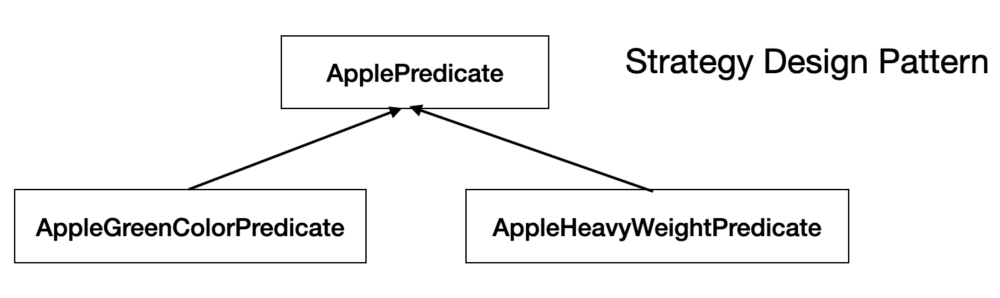

# 동작 파라미터화
- 변화하는 요구사항에 좀더 유연하게 대응
- 예: 다음과 같이 요구사항이 변화
	- 사과색이 녹색이 사과
	- 사과색이 빨간색인 사과
	- 사과무게가 150g인 사과 
	- 위와 같은 요구 사항에 대해 기존에는 매번 코드를 변경해 대응하였으나 요구 사항이 점점 많아지고 변화할 수록 <u>코드 수정이 빈번해짐</u>
- 요구사항이 잘 정의된 경우(문자열, 정수, boolean 으로 처리가능한 경우) 동작 파라미터화를 이용하여 유연성 확보

## 요구사항 대응하기
### predicate 인터페이스 정의
- 선택 조건을 결정하는 인터페이스

- 참 또는 거짓으로 결과 반환하는 함수 : predicate
```java
public interface ApplePredicate {
	boolean test(Apple apple); // 동작 파라미터화 처리 메소드, 또는 filter 메소드 라고도 지칭
}
```
- predicate를 구현한 요구사항 별 클래스 정의
	```java
	public class AppleRedColorPredicate implements ApplePredicate {
		public boolean test(Apple apple){}
	}
	```


- Runtime 시에 사용할 Predicate(또는 알고리즘) 선택
- 실제 사용할 필터핑 메소드에 Predicate 인자로 처리
	```java
	public static List<Apple> filterApples(List<Apple> inventory, ApplePredicate p) {
		...
		p.test(apple);
	
	}
	```
- ApplePredicate 객체에 의해 filterApples 메소드의 동작이 결정됨(어떤 ApplePredicate를 인자로 받아 들이냐에 따라 녹색사과인지 빨간 사과인지가 결정) => filterApple 메서드의 **동작파라미터화**
- 제약 : Predicate 객체에 감싸여서 test() 메서드 제공 -> 람다를 사용할 시 개별 Predicate 객체를 정의하지 않고 test() 정의 및 사용 가능

- 정리하면 한 메서드가 런타임시 다른 동작을 수행하도록 재활용하는 것을 **동적 파라미터화** 라고 함
## 복잡한 과정 간소화
- 여러 동작을 인터페이스로 구현하기 위해서는 여러 개의 predicate를 선언해야 함. -> 이 과정을 단순화 하기 위해 클래스 선언과 인스턴스화를 동시에 수행할 수 있는 익명 클래스 사용.
- 예제 (익명 클래스 정의)
```java

// new ApplePredicate() 로 익명 클래스 정의
List<Apple> redApples = filterApples(inventory, new ApplePredicate() {
	public boolean test(Apple apple) {
		return RED.equals(apple.getColor());
	}
}),
button.setOnAction(new EvenHandler<ActionEvent>() {. // 이벤트에 익명 클래스 많이 사용
	public boid handle(ActionEvent event) {
		System.out.println("Who a click");
	}
})
```
- 익명 클래스를 사용함으로써 전략 디자인 패턴에 기반한 인터페이스와 클래스 정의가 필요 없어짐
	- 익명 클래스 방식에 test() 메서드 등을 정의하지 않고 사용하면 람다 표현식임(더 단순화시킴)
		```java
		List<Apple> redApples = filterApples(inventory, (Apple apple) -> 
		RED.equals(apple.getColor()));
		```

- Predicate를 확장해서 다른 과일, 물건에 적용하려면 형식 파라미터(\<T>) 사용하여 정의(리스트 형식으로 추상화)
	```java
	public interface Predicate<T> {
		boolean test(T t);
	}
	
	public static <T> List<T> filter(List<T> list, Predicate<T> p) {
		List<T> result = new ArrayList<>();
		for(T e: list) {
			if (p.test(e)) {
				result.add(e),
			}
		}
		return result;
	}
	```

### 실전에제
- java comparator를 사용하여 동작 파라미터화를 처리
	```java
	public interface Comparator<T> {
		int compare(T o1, T o2);
	}
	
	// 정렬 메서드
	invertory sort(new Comparator<Apple>() {
		public int compare(Apple a1, Apple a2) {
			return a1.getWeight().compareTo(a2.getWeight());
		}
	});
	```
- 람다 표현식으로 표현 시(‼️람다를 사용하는 클래스는 메서드가 하나여야 함)
	```java
	invertory sort((Apple a1, Apple a2) -> a1.getWitght().compareTo(a2.getWeight()));
	```

- Thread Runnable을 람다 표현식으로 처리하기 쉬움
	```java
	Thread t = new Thread(new Runnable() {
		public void run() {
			System.out.println("Hello, World");
		}
	});
	
	// 람다 표현식 처리
	Thread t = new Thread(() -> System.out.println("Hello, World"));
	```

- ExecutorService 추상화 개념
	- 태스크 제출과 실행 과정의 연관성을 끊어줌
	- 장점 : 태스크를 스레드 풀로 보내고 결과를 Future에 저장
- ExecutorService 처리 람다 표현식
	```java
	ExecutorService executorService = Executors.newCachedThreadPool();
	Future<String> threadName = executorService.submit(new Callable<String>(){
		@Override
		public String call() throws Exception {
		return Thread.currentThread().getName();
		}
	});
	
	// 람다 표현식
	Future<String> threadName = executorService.submit( () ->
		Thread.currentThread().getName()
		);
	```
- GUI 이벤트 람다 표현식 처리
	```java
	button.setOnAction((ActionEvent event) -> label.setText("sent!!"));
	```
- 동작 파라미터화는 메서드 내부적으로 다양한 동작을 수행할 수 있도록 개별 동작 객체를 메서드 인수로 전달

