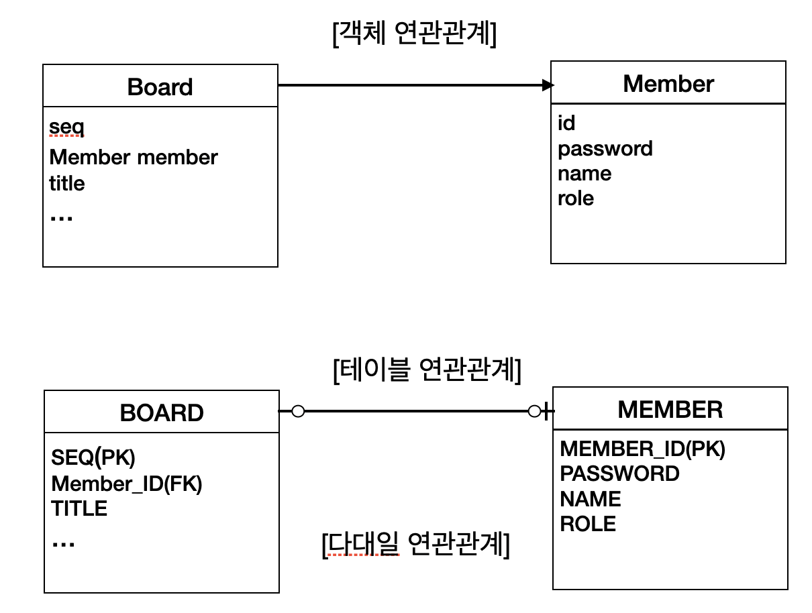
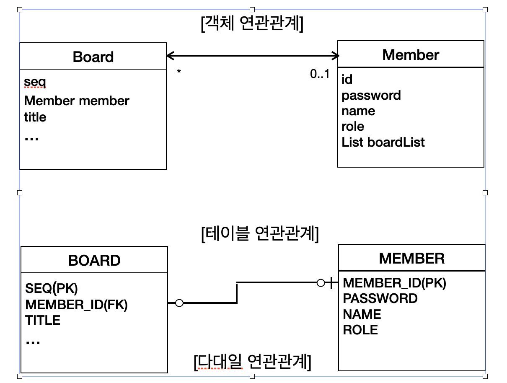

# JPA

## Spring Boot DB 연동
- 데이터 베이스 연동 방법
	- JDBA
	- Spring DAO
	- Mybatis
	- Hibernate 등 (ORM)
- ORM을 보다 쉽게 사용할 수 있도록 표준화 : JPA
- ORM 외의 DB 연동 방식 중 SQL를 사용하는 경우 테이블 변경에 따른 부가적인 SQL 변경이 수반됨 -> ORM은 그런 필요성이 수반되지 않는다.

## JPA 개념
- 하이버네이트는 기존의 EJB 기술인 엔티티 빈이 가지는 여러 문제를 대체하기 위한 오픈소스 프레임워크로 등장
- 하이버네이트 개발자들이 중심이 되어 만든 ORM표준이 JPA(Java Persistence API)
- JPA 구현체 종류
	- Hibernate (Spring Boot 사용)
	- EclipseLink
	- Datanucleus
- JPA는 자바 애플리케이션과 JDBC 사이에 존재하면서 JDBC의 복잡한 절차를 대신 처리
- 잠정: JPA로 데이터베이스 연동을 처리하면 개발 및 유지보수의 편의성이 극대화

## JPA 프로젝트 적용
- JPA 개념을 이해시키기 위한 샘플
- Java 프로젝트에 JPA만 추가
	- org.hibernate:hibernate-entitymanager 추가
	- src/main/java/META-INF : JPA환경설정 파일 persistence.xml 생성
### 엔티티 클래스 생성
- Value Object 클래스 생성
	- 테이블과 동일한 클래스 이름 사용
	- 컬럼과 매핑될 맴버 변수 선언
	- 해당 내역 자동으로 persistence.xml에 저장됨
- JPA Value Object Annotation
	- @Entity : 엔티티 클래스 선언
	- @Table(name"#") : 테이블 선언. name 내용 없을 시 엔티티명과 동일
	- @Id: 테이블의 기본 키 매핑. 필수
	- @GeneratedValue: 시퀀스 자동으로 생성
- JPA 설정 파일(persistence.xml)
	- jdbc 접속 정보
	- jpa 옵션 정보
		```xml
<persistence>
	</persistence-unit name="">
		<properties>
			<property name="javax.persistence.jdbc.driver" value="org.h2.Driver" />
			<property name="javax.persistence.jdbc.user" value="sa" />
			<property name="javax.persistence.jdbc.password" value="" />
			<property name="javax.persistence.jdbc.url" value="jdbc:h2:tcp://localhost/~/test" />
			<property name="hibernate.dialect" value="org.hibernate.dialect.H2Dialect" />
			
			<property name="hibernate.show_sql" value="true" />
			<property name="hibernate.format_sql" value="true" />
			<property name="hibernate.use_sql_comments" value="false" />
			<property name="hibernate.id.new_generator_mappings" value="true" />
			<property name="hibernate.hbm2ddl.auto" value="create" />
		</properties>
	</persistence-unit>
</persistence>
		```
		- hibernate.dialect : JPA 구현체가 사용할 Dialect 클래스 지정 ex) H2Dialect, OracleDialect
		- hibernate.hbm2ddl.auto : 테이블 시퀀스 자동 생성 옵션
#### 엔티티 등록
- 테이블 생성 및 데이터 등록 예제
	```java
	// EntityManager 생성. persistence.xml 의 persistence-unit name 참조
	EntityManagerFactory emf = Persistence.createEntityManagerFactory("");
	EntityManager em = emf.createEntityManager();
	try {
		// VO
		Board board = new Board();
		board.setTitle("JPA테스트");
		board.setWriter("관리자");
		board.setContent("JPA글 내용");
		board.setCreateDate(new Date());
		board.setCnt(0L);
		em.persist(board);
		
	} catch (Exception e) {
		e.printStackTrace();
	} finally {
		em.close();
		emf.close();
	}
	```
	- 위의 예제에서는 실제로 데이터가 DB에 저장되지 않음
	- JAP가 실제 테이블에 CRUD를 처리하기 위해서는 해당 작업이 반드시 **트랜잭션 안에서 수행**되어야 함
	- 주요 로직
		- EntityManagerFactory 인스턴스 생성
		- EntityManager 인스턴스 생성
		- EntityManager.persist() 로 데이터 저장
		- 자원 해제 em.close(), emf.close()
- 트랜잭션 처리
	```java
	// EntityManager 생성. persistence.xml 의 persistence-unit name 참조
	EntityManagerFactory emf = Persistence.createEntityManagerFactory("");
	EntityManager em = emf.createEntityManager();
	// Transaction 생성
	EntityTransaction tx = em.getTransaction();
	try {
		// VO
		Board board = new Board();
		board.setTitle("JPA테스트");
		board.setWriter("관리자");
		board.setContent("JPA글 내용");
		board.setCreateDate(new Date());
		board.setCnt(0L);
		
		// 글 등록
		em.persist(board);
		
		// transaction commit
		tx.commit();
		
	} catch (Exception e) {
		e.printStackTrace();
		tx.rollback();
	} finally {
		em.close();
		emf.close();
	}
	```
	- 주요 로직
		- EntityTransaction  인스턴스 생성
		- EntityTransaction commit, rollback 처리
- 예제는 매번 테이블을 생성하고 데이타를 등록하기 때문에 항상 한 건의 데이터만 존재
	- 데이터를 누적하기 위해서는 persistence.xml의 hibernate.hbm2ddl.auto 를 update로 수정

#### 검색
- 데이터 조회
	```java
	EntityManagerFactory emf = Persistence.createEntityManagerFactory(""); // persistence.xml 에 등록된 이름
	EntityManager em = emf.createentityManager();
	try {
		// 글 상세 조회
		Board searchBoard = em.find(Board.class, 1L);
	} catch (Exception e) {
		e.printStackTrace();
	} finally {
		em.close();
		emf.close();
	}
	```

### JPA 설정
- persistence.xml 에 JPA 설정 저장
- \<persistence> 가 최상위 루트
- \<persistence-unit> : 데이터베이스당 설정. 유일한 이름 설정
- 엔티티 클래스(테이블)은 생성 시 자동 등록됨. 
- 엔티티 클래스가 자동으로 등록되지 않을 시 수동 등록 가능
- 데이터 소스 설정
- Dialect 클래스 설정
	- 데이터 베이스 연동에 필요한 SQL 구문 설정

| 데이터 베이스       | Dialect 클래스                            |
| ------------- | -------------------------------------- |
| DB2           | org.hibernate.dialect.DB2Dialect       |
| PostgreSQL    | org.hibernate.dialect.PostgreDialect   |
| MySQL         | org.hibernate.dialect.MySQLDialect     |
| Oracle        | org.hibernate.dialect.OracleDialect    |
| Oracle 9i/10g | org.hibernate.dialect.Oracle9Dialect   |
| Sybase        | org.hibernate.dialect.SybaseDialect    |
| MS SQL Server | org.hibernate.dialect.SQLServerDialect |
| SAP DB        | org.hibernate.dialect.SAPDBDialect     |
| H2            | org.hibernate.dialect.H2Dialect        |

- JPA 구현체 설정

| **속성**                              | **의미**                                |
| ----------------------------------- | ------------------------------------- |
| hibernate.show_sql                  | 하이버네이트가 생성한 SQL을 콘솔에 출력               |
| hibernate.format_sql                | 하이버네이트가 생성한 SQL을 출력할 떄, 보기 좋은 포맷으로 출력 |
| hibernate.use_sql_comments          | SQL에 포함된 주석도 같이 출력                    |
| hibernate.id.new_generator_mappings | 키 생성 전략을 사용                           |
| hibernate.hbm2ddl.auto              | 테이블 생성이나 변경,삭제 같은 DDL 구문을 자동 실행할지 지정  |
	- hibernate.id.new_generator_mappings 는 유일키 자동 증가 옵션
	- hibernate.hbm2ddl.auto는 테이블 생성, 삭제 등 DDL 관련 옵션
			- 옵션
				- create: 애플리케이션 실행 시 기존 테이블 삭제 후 새로운 테이블 생성
				- create-drop: 애플리케이션이 종료되기 직전에 생성된 테이블 삭제
				- update : 기존에 사용중인 테이블이 있으면 테이블을 생성하지 않고 재사용

### 엔티티 매핑
- 엔티티 클래스에 매핑과 관련된 어노테이션 설정
- 엔티티들의 관계 매핑하는 연관관계 매핑이 복잡
#### 엔티티 어노테이션
- @Entity : 자바 클래스를 JPA가 관리하는 엔티니로 인식
- @id: 엔티티 식별자 필드
- @Table : 엔티티 이름과 테이블 이름 매핑(서로 다를 경우)
	- 추가 속성
		- name: 매핑될 테이블 이름
		- catalog: 데이터베이스 카탈로그 지정
		- schema: 데이터베이스 스키마 지정
		- uniqueConstraints : 겹합 unique 제약조건 지정, 여러 개의 컬럼이 결합되어 유일성을 보장해야 하는 경우 사용
			```java
			@Entity
			@Table(name="Board", 
			uniqueConstaints={@UniqueConstraint(columnNames={"SEQ", "WRITER"})})
			public class Board {}
			```
- @Column : 엔티티의 변수와 테이블 컬럼 매핑(변수과 컬럼 이름이 다를 때)
	- 컬럼 속성

| **속성** | **설명**|
| ---- | ---- |
| name | 컬럼 이름을 지정|
|unique|unique 제약 조건을 추가(기본값: false)|
|nullable|null 상태 허용 여부를 설정(기본값: false)|
|insertable|INSERT를 생성할 떄 이 컬럼을 포함할 것인지 결정(기본값: true)|
|updatable|UPDATE를 생성할 떄 이 컬럼을 포함할 것인지 결정(기본값: true)|
|columnDefinition|이 컬람에 대한 DDL문을 직접 기술|
|length|문자열 타입의 컬럼 길이를 지정(기본값:255)|
|precision|숫자 타입의 전체 자릿수를 지정(기본값:0)|
|scale|숫자 타입의 소수점 자리수를 지정(기본값:0)|

	- 사용 예

| **사용**                                                                                   | **생성된 DDL**                                                                                     |
| ---------------------------------------------------------------------------------------- | ----------------------------------------------------------------------------------------------- |
| @Column(nullable = false) private String title                                           | title varchar(255) not null                                                                     |
| @Column(unique = true) private String isbn;                                              | alter table Tablename add constraint UK_Xxx unique(isbn)                                        |
| @Column(columnDefinition = "varchar(100) default 'No Contents'") private String content; | content varchar(100) default 'No Contents'                                                      |
| @Column(length = 40) private String writer;                                              | writer varchar(40)                                                                              |
| @Column(precesion = 10, scale = 2) private BigDecimal point;                             | point numeric(10,2) // H2. PostgreSQL point number(10,2) // Oracle point decimal(10,2) // MySQL |
- @Temporal: java.util.Date 타입의 날짜 데이터 매핑 시 사용
	- TemporalType.Date : 날짜만 출력
	- TemporalType.Time : 시간만 출력
	- TemporalType.TIMESTAMP : 날짜와 시간 모두 출력
	- 예제
		```java
		@Temporal(TemporalType.DATE)
		private Date createDate;
		```
- @Transient : 매핑되는 컬럼이 없거나 검색 관련 변수 같이 임시로 사용되는 변수 매핑 제외
	```java
	@Entity
	@Table(name = "Board")
	public class Board {
		@Id
		@GeneratedValue
		private long seq;
		
		@Transient
		private String searchCondition;
		
		@Transient
		private String searchKeyword;
	}
	```

### 식별자 자동 증가
- @Id: 식별자 필드, 값 설정되지 않으면 예외 발생
- 식별자 필드에 자동 증가 값을 할당 시 @GeneratedValue 사용

#### @GeneratedValue 의 다양한 전략
- 속성: strategy, generator
	- strategy: 자동 생성 전략 선택. GenerationType 지정
	- generator: 이미 생성된 키 생성기 참조
- strategy
| PK전략 | 해설|
| ------ | ---- |
|GenerationType.TABLE | 테이블을 사용하여 PK값을 생성. PK값 생성만을 위한 별도의 테이블 필요 |
|GenerationType.SEQUENCE| 시퀀스를 이용하여 PK갑 생성 |
|GenerationType.IDENTITY|auto_increment나 IDENTITY를 이용하여 PK갑 생성. MySQL같은 데이터베이스 이용 시 사용|
|GenerationType.AUTO| 하이버네이트가 데이터베이스에 맞는 PK생성 전략을 선택(기본값)|

##### 테이블을 사용한 키 생성 전략
- 예제(테이블을 사용한 생성 전략)
	```java
	@Entity
	@TableGenerator(name = "BOARD_SEQ_GENERATOR",
	table = "ALL_SEQUENCES",
	pkColumnValue = "BOARD_SEQ",
	initialValue = 0,
	allocationSize = 1)
	pulic class Board {
		@Id
		@GeneratedValue(strategy = GenerationType.TABLE,
		generator = "BOARD_SEQ_GENERATOR")
		private Long seq;
		private String title;
		private String writer;
			...
	}
	```
	- ALL_SEQUENCES 테이블에 BOARD_SEQ 이름으로 증가하는 값 저장
	- 값 생성 전략을 GenerationType.TABLe 선택, 값 생성기 BOARD_SEQ_GENERATOR 지정
	- 값 생성 테이블이 자동 생성되기 위해서 persistence.xml의 hibernate.hbm2ddl.auto 속성을 create로 변경
##### 시퀀스 전략 사용하기
- 시퀀스를 사용해 키 생성
- 예제
	```java
	@Entity
	@SequenceGenerator(name = "BOARD_SEQ_GENERATOR",
	sequenceName = "BAORD_SEQUENCE",
	initialValue = 1,
	allocationSize = 1)
	public class Board {
		@Id
		@GeneratedValue(strategy=GenerationType.SEQUENCE,
		generator = "BAORD_SEQ_GENERATOR")
		private Long seq;
	}
	```
	- strategy 에 GenerationType.SEQUENCE 정의
	- JPA가 시퀀스 자동 생성함.

##### 테이블 전략 vs 시퀀스 전략
- 테이블 전략은 데이터 베이스에 무관하여 범용적으로 사용 가능
- 테이블을 별도로 생성, 키값을 자동으로 생성하기 위해 별도의 Update작업 수행 필요
- 시퀀스 전략은 별도의 테이블이 필요 없고, 처리 속도 빠름
- 시퀀스를 지원하는 데이터 베이스에서만 사용 가능

##### 자동 전략 사용하기
- 연동하는 데이터 베이스와 무관하여 키 생성 전략 사용
- 식별자 필드에 @GeneratedValue만 정의하면 기본값이 AUTO가 적용
- 예제
	```java
	@Entity
	public class Board {
		@Id
		@GeneratedValue
		private Long seq;
		
	}
	```

## JPA API
### EntityManagerFactory, EntityManager
- 애플리케이션에서 JPA를 이용하여 CRUD기능 처리시 **EntityManager** 객체 사용
- EntityManagerFactory가 EntityManager 생성
- Persistence Unit 당 EntityManagerFactory 생성
- EntityManager가 제공하는 CRUD  메소드

| 메소드                                            | 기능 설명                                 |
| ---------------------------------------------- | ------------------------------------- |
| persist(Object entity)                         | 엔티티를 영속화한다(INSERT)                    |
| merge(Object entity)                           | 준영속 상태의 엔티티를 영속화한다.(UPDATE)           |
| remove(Object entity)                          | 영속 상태의 엔티티를 제거한다.(DELETE)             |
| find(Class<T> entityClass, Object primaryKey)  | 하나의 엔티티를 검색한다.(SELECT ONE)            |
| createQuery(String jpql, Class<T> resultClass) | JPQL에 해당하는 엔티티 목록을 검색한다.(SELECT LIST) |
### Persistence Context(영속성 컨텍스트)
- EntityManager를 생성할 때 자동으로 생성됨 - 논리적인 구조라 이해하면 됨
- 엔티티 객체들을 관리하는 일종의 컨테이너
- EntityManager를 통해서 접근
- 영속성 컨텍스트에 등록된 엔티티는 비영속(New), 영속(Managed), 준영속(Detached), 삭제(Removed) 상태로 존재
- 엔티티 상태
	- 비영속(New) : 엔티티 객체를 생성만 하고 아직 영속성 컨텍스트에 저장하지 않은 상태
	- 영속(Managed): EntityManager를 통해 엔티티가 영속성 컨텍스트에 저장된 상태.
	- 준영속(Detached): 한번 영속성 컥텍스트에 들어간 엔티티가 어떤 이유에서인지 영속성 컨텍스트에서 벗어난 상태(detach(), clear(), close() 메소드 호출했을 때)
	- 삭제 상태(Removed): 엔티티가 영속성 컨텍스트에서 제거되고 테이블의 데이터도 삭제된 상태
#### 영속성 컨텍스트와 1차 캐시
- 절차 : EntityManger의 persist() 메소드를 통해 특정 엔티티를 영속성 컨텍스트에 등록하면 저장된 엔티티에 해당하는 INSERT가 실행.
- But JPA가 persist()를 호출했다고 해도 곧바로 테이블에 INSERT하지 않음 -> 영속성 컨텍스트 내부에 1차 캐시를 사용
- 실제 반영은 EntityTransaction으로 트랜잭션을 종료할 때 실제 데이터 베이스에 반영
- 영속성 컨텍스트에 저장된 엔티티를 데이터베이스에 반영하는 과정을 Flush 라 함.

#### 영속성 컨텍스트와 SQL저장소
- 엔티티를 persist() 메소드로 영속성 컨텍스트에 저장시 발생하는 절차
	1. 엔티티를 1차 캐시에 등록
	2. INSERT 구문을 생성하여 SQL 저장소에 등록
- 새로운 엔티티가 등록되면 등록 순서대로 1차 캐시와 SQL 저장소에 누적되어 저장됨
- commit 등 트랜잭션을 종료하면 모든 SQL이 데이터베이스에 적용됨.
- 배치와 같은 적용으로 성능 최적화함 

#### 스냅샷
- 엔티티 상태가 영속인 건에 대해서 수정 등을 하기 위해 검색 후 영속성 컨텍스트에 저장할 때, 엔티티 복사본을 만들어서 별도의 컬렉션에 저장 -> 이 저장 공간을 스냅샷 이라 함.
- 이후 수정 작업 등이 발생하고 트랜잭션을 종료할 때, 스냅샷에 저장된 엔티티와 1차 캐시에 수정된 엔티티를 비교해서 변경된 값을 이용하여 UPDATE SQL을 만듬.
- JPA의 기본 전략은 모든 필드 수정 - 수정 쿼리가 항상 같기 때문에 한번 파싱한 쿼리를 재사용가능 -> 성능상의 이점을 가짐 => 비교 대상인 스냅샷이 필요.

- ⚠️ JPA에서 수정,삭제 시에는 항상 엔티티가 영속 상태(영속성 컨텍스트에 저장된)여야 함. -> 먼저 검색을 통해 엔티티를 영속성 컨텍스트에 저장해야함.

#### 목록 검색
- 특정 데이터를 상세 조회 시 find() 사용
- 목록을 검색하려면 JPQL 이라는 JPA에서 제공하는 별도의 쿼리 명령어 사용
- 예제
	```java
	public class JPAClient {
		public static void main(String[] args) {
			...
			String jpql = "select b from Borad b order by b.seq desc";
			List<Board> boardList = 
			em.createQueryy(jpql, Board.class).getResultList();
			
			for ( Board brd: boardList) {
				System.out.println("---> " + brd.toString());
			}
		}
		
		
	}
	```

## Spring Data JPA

### Spring Data JPA Starter
- JPA 스타터 : Spring Boot에서 JPA를 사용하기 위한 설정 및 초기화 지원
- Spring-Boot-Data-JPA-Starer dependency 에 추가

#### Spring Data JPA 사용
##### 설정
- 데이터 베이스 정의
	- application.properties or application.yml 에 연동할 데이터 베이스 정의
		```properties
		
		# DataSource Setting 
		spring.datasource.driver-class-name=org.h2.Driver
		spring.datasource.url=jdbc:h2:tcp://localhost/~/test
		spring.datasource.username=sa
		spring.datasource.password=
		
		# JPA Setting
		spring.jpa.hibernate.ddl-auto=create
		spring.jpa.generate-ddl=false
		spring.jpa.show-sql=true
		spring.jap.database-platform=org.hibernate.dialect.H2Dialect
		spring.jpa.properties.hibernate.format_sql=true
		
		@Logging Setting
		loggin.level.org.hibernate=info
		```
	- ‼️팁 : h2 db가 생성이 안 되어 DB 접속이 되지  않는 경우가 간혹 발생. 그럴 때는 jdbc:h2:~/test로 설정해서 사용(tcp 접속이 아닌 로컬 접속으로 변경)

##### 구현
- Entity 클래스 생성
	```java
	@Getter
	@Setter
	@ToString
	@Entity
	public class Board {
		@Id @GeneratedValue
		private Long seq;
		private String title;
		private String writer;
		private String content;
		@Temporal(value = TemporalType.TIMESTAMP)
		private Date createDate;
		private Long cnt;
	}
	```
- Repository 인터페이스 구현(CRUD 처리)
	```java
	public interface BoardRepository extends CrudRepository<Borad, Long> {
	}
	```
	- JpaRepository 상속 받아 사용. 용도에 맞쳐 검색 기능 적용시 PagingAndSortingRepository, CRUD 기능 필요시 CrudRepository  등 적용
	- 인터페이스만 구현하면 Spring Boot 에서 구현 객체 자동 생성
	- JPA에서 사용한 EntityManagerFactory, EntityManager, EntityTransaction 객체 필요 없음

- CRUD 메소드

| 메소드                                           | 변경                       | 기능                      |
| --------------------------------------------- | ------------------------ | ----------------------- |
| long count()                                  |                          | 모든 엔티티의 개수 리턴           |
| void delete(ID)                               |                          | 식별 키를 통한 삭제             |
| void delete(Iterable<\? Extends T>)           |                          | 주어진 모든 엔티티 삭제           |
| void deleteAll()                              |                          | 모든 엔티티 삭제               |
| boolean exists(ID)                            |                          | 식별 키를 가진 엔티티가 존재하는지 확인  |
| Iterable<T> findAll()                         | findAllById<ID>          | 모든 엔티티 목록 리턴            |
| Iterable<T> findAll(Iterable<ID>)             |                          | 해당 식별 키를 가진 엔티티 목록 리턴   |
| T findOne<ID>                                 | Optional<T> findById<ID> | 해당 식별 키에 해당하는 단일 엔티티 리턴 |
| \<S extends T>Iterable\<S> save(Iterable\<S>) | saveAll<Iterable>        | 여러 엔티티들을 한 번에 등록, 수정    |
| \<S extends T>S save\<S entity>               |                          | 하나의 엔티티를 등록, 수정         |
- 예제
	```java
	@RunWith(SpringRunner.class)
	@SpringBootTest
	public class BoardRepositoryTest {
		@Autowired
		private BoardRepository boardRepo;
		
		@Test
		public void testInsertBoard() {
			Board board = new Board();
			board.setTitle("첫 번째 게시글");
			board.setWriter("테스터");
			board.setContent("등록");
			board.setCreateDate(new Date());
			board.setCnt(0L);
			
			boardRepo.save(board);
		}
		
		@Test
		public void testGetBoard() {
			Board board = boardRepo.findById(1L).get();
			System.out.println(board.toString());
		}
		
		@Test
		public void testUpdateBaord() {
			Board board = boardRepo.findById(1L).get();
			
			board.setTitle("1번 게시글 수정");
			boardRepo.save(board);
		}
		
		@Test
		public void testDeleteBoard() {
			boardRepo.deleteById(1L);
		}
	}
	```
- 앞서 설명한 JPA 에서 수정, 삭제 시 영속성 컨텍스트에 엔티티를 미리 저장해야 하는데 Sprnig Boot JPA에서는 해당 과정을 자동으로 처리한다. -> 별도로 구현할 필요 없음.

#### 쿼리 메소드 사용
- JPQL을 이용하여 처리
- 메소드 명으로 자동으로 쿼리 검색
- 쿼리 메소드의 리턴 타입은 Page\<T>, Slice\<T>, List\<T> 
	- paging 처리 : Page\<T>
	- 단순 목록 처리 : List\<T>
- 쿼리 메소드 사용 시 해당 Repository 인터페이스에 선언된 타입과 동일할 때 엔티티 이름 생략 가능
	- 예) findBoardByTitle() : Repository 에 Board 타입이 선언되었을 떄 -> findBytitle()  사용 가능
- 예제
	```java
	public interface BoardRepository extneds CrudRepository<Board, Long> {
		List<Board> findByTitle(String searchKeyword);
	}
	```

- 쿼리 메소드 유형

| 키워드                | 예                                  | 생성되는 SQL                                   |
| ------------------ | ---------------------------------- | ------------------------------------------ |
| And                | findByLastnameAndFirstname         | where x.lastname = ?1 and x.firstname = ?2 |
| Or                 | findByLastnameOrFirstname          | where x.lastname =1 or x.firstname = ?2    |
| Between            | findByStartDateBetween             | where x.startDate between ?1 and ?2        |
| LessThan           | findByAgeLessThan                  | where x.age > ?1                           |
| LessThanEqual      | findByAgeLessThanEqual             | where x.age >= ?1                          |
| GreaterThan        | findByAgeGreaterThan               | where x.age > ?1                           |
| GreaterThanEqual   | findByAgeGreaterThanEqual          | where x.age >= ?1                          |
| After              | findByStartDateAfter               | where x.startDate > ?1                     |
| Before             | findByStartDateBefore              | where x.startDate > ?1                     |
| IsNull             | findByAgeIsNull                    | where x.age is null                        |
| IsNotNull, NotNull | findByAge(Is)NotNull               | where x.age is not null                    |
| Like               | findByFirstnameLike                | where x.firstname like ?1                  |
| Not Like           | findByFirstnameNotLike             | where x.firstname not like ?1              |
| StartingWith       | findByFirstnameStartingWith        | where x.firstname like ?1\|\|'%'           |
| EndingWith         | findByFirstnameEndingWith          | where x.firstname like '%'\|\|?1           |
| Containing         | findByFirstnameContaining          | where x.firstname like '%'\|\|?1\|\|'%'    |
| OrderBy            | findByAgeOrderByLastnameDesc       | where x.age = ?1 order by x.lastname desc  |
| Not                | findByLastnameNot                  | where x.lastname <> ?1                     |
| In                 | findByAgeIn(Collection\<Age> ages) | where x.age in ?1                          |
- 예제
	```java
	pbulic interface BoardRepository extends CrudRepository<Board, Long> {
		// 게시글 내용에 특정 단어 포함된 목록 검색 
		List<Board> findByContentContaining<String searchKeyword);
		
		// 게시글 제목 혹은 내용에 특정 단어가 포함된 글 목록 조회
		List<Board> findByTitleContainingOrContentContainint(String title, String content);
		
		// 데이터 정력
		List<Board> findByTitleContainingOrderBySeqDesc(String searchKeyword);
		
		// 페이징 처리 paging 에 PageRequest.of(0,5) 정의 (page번호, 데이터 수)
		List<Board> findByTitleContaining(String searchKeyword, Pageable paging);
		
		// Page<>  사용
		Page<Board> findByTitleContaining(String searchKeyword, Pageable paging);
		
	}
	```
	- 페이지 처리에 데이터 정렬를 하려면 findByTitleContaining() 메소드의 Pageable 에 정렬을 추가 
		- PageRequest.of(0, 5, sort.Direction.DESC, "Seq")
	- Page<> 를 사용하면 페이징 처리에 필요한 다양한 정보를 Page 객체를 통해 추출 가능

| 메소드                          | 설명               |
| ---------------------------- | ---------------- |
| int getNumber()              | 현재 페이지 정보        |
| int getSize()                | 한 페이지의 크기        |
| int getTotalPages()          | 전체 페이지의 수        |
| int getNumberOfElements()    | 결과 데이터 수         |
| boolean hasPreviousPage()    | 이전 페이지의 존재 여부    |
| boolean hasNextPage()        | 다음 페이지의 존재 여부    |
| boolean isLastPage()         | 마지막 페이지 여부       |
| Pageable nextPageable()      | 다음 페이지 객체        |
| Pageable previeousPageable() | 이전 페이지 객체        |
| List\<T> getContent()        | 조회된 데이터 목록       |
| Boolean hasContent()         | 결과 존재 여부         |
| Sort getSort()               | 검색 시 사용된 Sort 정보 |
#### @Query 어노테이션 사용
- 복잡한 쿼리 및 연관관계에 기반한 join 검색을 처리하기 위해 JPQL 사용이 필요한 경우
- 사용예
	```java
	public interface BoardRepository extends CrudRepository<Board, Long> {
	
		// @Query  사용 위치기반 파라미터 사용
		@Query("SELECT b FROM Board b WHERE b.title like %?1% ORDER BY b.seq DESC")
		List<Board> queryAnnotationTest1(String searchKeyword);
		
		// 이름기반 파라미터 사용
		@Query("SELECT b FROM Board b WHERE b.title like %:searchKeyword% ORDER By b.seq DESC")
		List<Board> queryAnnotationTest2(@Param("searchKeyword") String searchKeyword);
		
		// 특정 변수만 조회
		@Query("SELECT b.seq, b.title, b.writer, b.createDate "
		    + "FROM Baord b "
		    + "WHERE b.title like %?1% "
		    + "ORDER BY b.seq DESC")
		List<Object[]> queryAnnotationTest3(String searchKeyword);
	}
	```
	- JPQL은 검색 대상이 영속성 컨텍스트에 저장된 엔티티. 
	- 검색 대상 엔티티명과 컬럼 이름도 엔티티에 등록된 필드명 사용 
	- 입력값 바이딩을 하기 위해 위치기반 파라미터(?1) 와 이름 기반 파라미터(:keyword) 사용
	- 이름 기반 파라미터를 사용하기 위해 매개 변수에 @Param  추가 
	- 특정 변수 이름만 조회 시 Board 엔티티가 아닌 Obejct로 리턴 처리
- @Query를 사용해 특정 데이터 베이스에서만 사용하는 네이티브 쿼리 실행 가능
	- 쿼리가 특정 데이터 베이스에 종속
	- 성능 상 특정 데이터 베이스에 최적화된 쿼리 사용 가능
	- 사용예
	```java
	public interface BoardRepository extends CrudRepository<Board, Long> {
		@Query(value="select seq, title, writer, create-date "
		    + "from board where title like '%'||?1||'%' "
		    + "order by seq desc", nativeQuery=true)
		List<Object[]> queryAnnotationTest3(String searchKeyword);
	}
	```

#### QueryDSL을 이용한 동적 쿼리 적용
- mybatis는 동적 태그를 이용하여 XML파일에 등록되는 쿼리를 동적 구성 ㄱ능
- JPA는 @Query를 이용해서 애플리케이션에 사용할 쿼리 관리
	- 프로젝트가 로딩되는 시점에 파싱되기 때문에 고정된 SQL만 사용 가능
- QueryDSL은 동적 쿼리를 처리하기 위해 사용
	- 쿼리를 문자열이 아닌 자바 코드로 작성할 수 있도록 지원하는 일종의 JPQL 빌더 

##### 설정
- com.querydsl:querydsl-jap, com.querydsl:querydsl-apt dependency에 추가
- 쿼리 타입을 위한 쿼리용 클래스를 생성하기 위한 플러그인 추가
	- com.mysema.maven:apt-maven-plugin  추가
	```xml
<plugins>
	<plugin>
		<groupId>com.mysema.maven</groupId>
		<artifactId>apt-maven-plugin</artifactId>
		<version>1.1.3</version>
		<executions>
			<execution>
				<goals>
					<goal>process</goal>
				</goals>
				<configuration>
					<outputDirectory>src/main/querydsl</outputDirectory>
					<processor>com.querydsl.apt.jpa.JPAAnnotationProcessor</processor>
				</configuration>
			</execution>
		</executions>
	</plugin>
</plugins>
	```

##### 동적 쿼리 사용
- Repository 인터페이스가 QeurydslPredicateExecutor 인터페이스 상속
- 예제
	```java
	public interface DynamicBoardRepository extends CrudRepository<Board, Long>, QuerydslPredicateExecutor<Board> {
	}
	```

- QuerydslPredicateExecutor 제공 메소드

| 메소드                                       | 설명                  |
| ----------------------------------------- | ------------------- |
| long count(Predicate p)                   | 검색된 데이터의 전체 개수      |
| boolean exists(Predicate p)               | 검색된 데이터의 존재 여부      |
| Iterable\<T> findAll(Predicate p)         | 조건에 맞는 모든 데이터 목록    |
| Page\<T> findAll(Predicate p)             | 조건에 맞는 모든 데이터 목록    |
| Iterable\<T> findAll(Predicate p, Sort s) | 조건에 맞는 모든 데이터 목록 정렬 |
| T findOne(Predicate p)                    | 조건에 맞는 하나의 데이터      |
- 예제
	```java
	@RunWith(SpringRunner.class)
	@SpringBootTest
	public class DynamicQueryTest {
		@Autowired
		private DynamicBoardRepository boardRepo;
		
		@Test
		public void testDynamicQuery() {
			String searchCondition = "TITLE";
			String searchKeyword = "테스트 제목 10";
			
			BooleanBuilder builder = new BooleanBuilder();
			
			QBoard qboard = QBoard.board;
			
			// 동적 쿼리 정의
			if (searchCondition.equals("TITLE")) {
				builder.and(qboard.title.like("%" + searchKeyword + "%"));
			} else if (searchCondition.equals("CONTENT")) {
				builder.and(qboardcontent.like("%" + searchKeyword + "%"));
			}
			
			Pageable paging = PageRequest.of(0, 5);
			
			Page<Board> boardList = boardRepo.findAll(builder. paging);
			
			for (Board boatrd: boardList) {
				System.out.println("---> " + board.toString());
			}
		}
	}
	```

### 테이블 연관관계 매핑
#### 단방향 연관관계 설정
- 객체는 참조 변수를 통해 다른 객체와 관계 맺음
- 관계형 데이터 베이스는 foreign key를 이용하여 다른 테이블과 관계 맺음 

##### 다대일(N:1) 단방향 매핑


- 연관관계 매핑
	```java
	@Getter
	@Setter
	@ToString
	@Entity
	public class Member {
		@Id
		@Column(name="MEMBER_ID")
		private String id;
		private String password;
		private String name;
		private String role;
	}
	```
	- build 시 src/main/querydsl 폴더에 QMember 클래스 자동 생성 확인
		- 자동 생성 안 되면 gradle 사용 시 gradle version 등 체크해야 함.
- Board 클래스 다대일 연관 매핑 설정 추가
	```java
	@Getter
	@Setter
	@ToString
	@Entity
	pubilc class Board {
		@Id @GeneratedValue
		private Long seq;
		private String title;
		private String content;
		@Temporal(value = TemporalType.TIMESTAMP)
		private Date createDate;
		private Long cnt;
		
		@ManyToOne
		@JoinColumn(name="MEMBER_ID")
		private Member member;
	}
	```
	- 다대일 관계를 설정하기 위해 member 변수 위에 @ManyToOne 어노테이션 추가
	- @ManyToOne 어노테이션 속성
		- optional: 연관된 엔티티가 반드시 있어야 하는지의 여부 결정. 기본값 true. false로 설정하면 항상 있어야 함
		- fetch: 글로벌 패치 전략 설정. EAGER 연관 엔티티를 동시에 조회, LAZY는 연관 엔티티를 실제 사용할 때 조회
		- cascade: 영속성 전이 기능 설정. 연관 엔티티를 같이 저장하거나 삭제할 때 사용
	- 외래 키 매핑을 위해 @JoinColumn 어노테이션 사용
		- 참조하는 테이블의 외래 키 컬럼 매핑

- 테스트 예제
	```java
	@RunWith(SpringRunner.class)
	@SpringBootTest
	public class RelationMappingTest {
		@Autowired
		private BoardRepository boardRepo;
		
		@Autowired
		private MemberRepository memberRepo;
		
		@Test
		public void testManyToOneInsert() {
			Member member1 = new Member();
			member1.setId("member1");
			member1.setPassword("member111");
			member1.setName("둘리");
			memeber1.setRole("User");
			memberRepo.save(member1);
			
			Member member2 = new Member();
			member2.setId("member2");
			member2.setPassword("member222");
			member2.setName("도우너");
			member2.setRole("Admin");
			memberRepo.save(member2);
			
			for (int i = 1 i <=3; i++) {
				Board board = new Board();
				board.setMember(member1);
				board.setTitle("둘리가 등록한 게시글 " + i);
				board.setContent("둘리가 등록한 게시글 내용 " + i);
				board.setCreateDate(new Date());
				board.setCnt(0L);
				boardRepo.save(board);
			}
			
			for (int i = 1 i <=3; i++) {
				Board board = new Board();
				board.setMember(member2);
				board.setTitle("도우너가 등록한 게시글 " + i);
				board.setContent("도우너가 등록한 게시글 내용 " + i);
				board.setCreateDate(new Date());
				board.setCnt(0L);
				boardRepo.save(board);
			}
		}
		
		@Test
		pbulic void testManyToOneSelect() {
			Board board = boardRepo.findById(5L).get();
			System.out.println("[ " + board.getSeq() + "번 게시글 정보]");
			System.out.println("제목 : " + board.getTitle());
		}
	}
	
	```
	- BOARD 테이블의 member_id 필드에 회원ID 정보 삽입됨
	- testManyToOneSelect() 메소드 실행 시 콘솔에 출력되는 쿼리를 확인해 보면 outer join으로 연결됨
		- outer join는 성능상 inner join보다 좋지 않음. 
		- inner join으로 변경하려면 <u>@JoinColumn에 nullable 속성 추가</u>
			- @JoinColumn(name="MEMBER_ID", nullable=false)

#### 양방향 연관관계 매핑

- 게시판에서 회원 정보에만 접근하는 것이 아닌 회원에서 게시판에 접근할 수 있는 관계 추가
- 테이블에서는 외래 키 하나로 조인을 통해 양방향 조회가 가능하므로 별도 추가 내용 없음

- Member entity에 연관관계 추가
	```java
	@Getter
	@Setter
	@ToString
	@Entity
	public class Member {
		@Id
		@Column(name="MEMBER_ID")
		private String id;
		private String password;
		private String name;
		private String role;
		
		// 연관관계 추가
		@OneToMany(mappedBy="member", fetch=FetchType.EAGER)
		private List<Board> boardList = new ArrayList<Board>();
	}
	```
	- fetch: 회원 정보를 조회할 때 연관 관계에 있는 게시판의 정보도 같이 조회할 것인지 결정
		- EAGER 는 같이 조회할 때 설정
	- mappedBy: 양방향 연관관계에서 연관관계의 주인을 지정할 때 사용
		- 매핑에 참여하는 참조 변수는 2개이고 어떤 변수로 관리할 것인지 결정
		- 여기서는 Board 클래스의 member 변수를 지정

- 테스트
	```java
	public class RelationMappingTest {
		@Test
		public void testTwoWayMapping() {
			Member member = memberRepo.findById("member1").get();
			
			System.out.println(member.getName() + "가(이) 저장한 게시글 목록");
			
			List<Board> list = member.getBoardList();
			for (Board board: list) {
				System.out.println(board.toString());
			}
		}
	
	}
	```
	- 회원 정보 출력 후, 게시판 목록 출력 때 오류 발생(StackOverflowError)
		- @ToString이 양방향 참조에서 상호 호출함.(Board -> member -> board)
		- @ToString 에 exclude 속성을 추가하여 상호 호출 제거
		- Board.java 에서 @ToString(exclude="member") 추가
		- Member.java 에서 @ToString(exclude="boardList") 추가

##### 영속성 전이
- 특정 엔티티를 영속 상태로 만들거나 삭제 상태로 만들 때 연관된 엔티티도 같이 처리할 경우<u> 영속성 전이</u>를 사용하면 관리 편함
- 테이블 연관관계 어노테이션의 cascade 속성 추가
- 예제
	```java
	public class Member {
		@OneToMany(mappedBy="member", fetch=FetchType.EAGER, cacade=CascadeType.ALL)
		private List<Board> boardList = new ArrayList<Board>();
	}
	```
	- CascadeType
		- ALL: 객체가 영속화되거나 수정, 삭제 될 때 관련된 객체도 같이 변경됨
		- PERSIST
		- MERGE
		- REMOVE
		- REFRESH
		- DETACH
- Board 객체에 값 설정 시, Member 객체의 boardList에도 같이 설정되도록 수정
	```java
	public class Board {
		...
		public void setMember(Member member) {
			this.member = member;
			member.getBoardList().add(this);
		}
	}
	```

- 테스트 클래스에 inset 메소드 수정
	```java
	@Test
		public void testManyToOneInsert() {
			Member member1 = new Member();
			member1.setId("member1");
			member1.setPassword("member111");
			member1.setName("둘리");
			memeber1.setRole("User");
			//memberRepo.save(member1);
			
			Member member2 = new Member();
			member2.setId("member2");
			member2.setPassword("member222");
			member2.setName("도우너");
			member2.setRole("Admin");
			//memberRepo.save(member2);
			
			for (int i = 1 i <=3; i++) {
				Board board = new Board();
				board.setMember(member1);
				board.setTitle("둘리가 등록한 게시글 " + i);
				board.setContent("둘리가 등록한 게시글 내용 " + i);
				board.setCreateDate(new Date());
				board.setCnt(0L);
				//boardRepo.save(board);
			}
			memberRepo.save(member1);
			
			for (int i = 1 i <=3; i++) {
				Board board = new Board();
				board.setMember(member2);
				board.setTitle("도우너가 등록한 게시글 " + i);
				board.setContent("도우너가 등록한 게시글 내용 " + i);
				board.setCreateDate(new Date());
				board.setCnt(0L);
				//boardRepo.save(board);
			}
			memberRepo.save(member2);
		}
	```
- Member 객체만 영속화시키면 Member가 가진 boardList 컬렉션에 저장된 모든 Board 객체가 자동으로 영속화됨
- 부모에 해당하는 특정 회원 객체를 삭제하면 삭제된 회원과 관련된 게시판 엔티티도 자동으로 삭제됨
	```java
	@Test
	public void testCascadeDelete() {
		memberRepo.deleteById("member2");
	}
	```